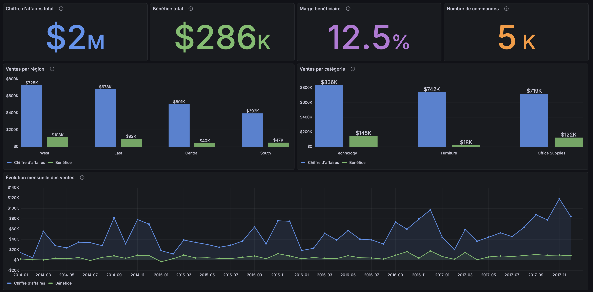
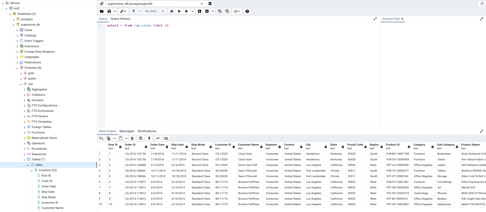
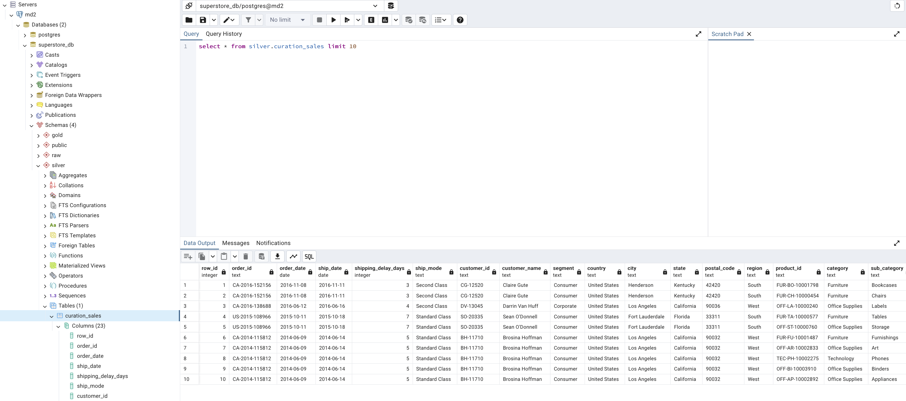
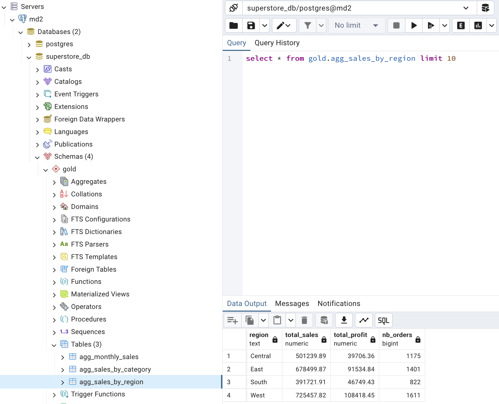
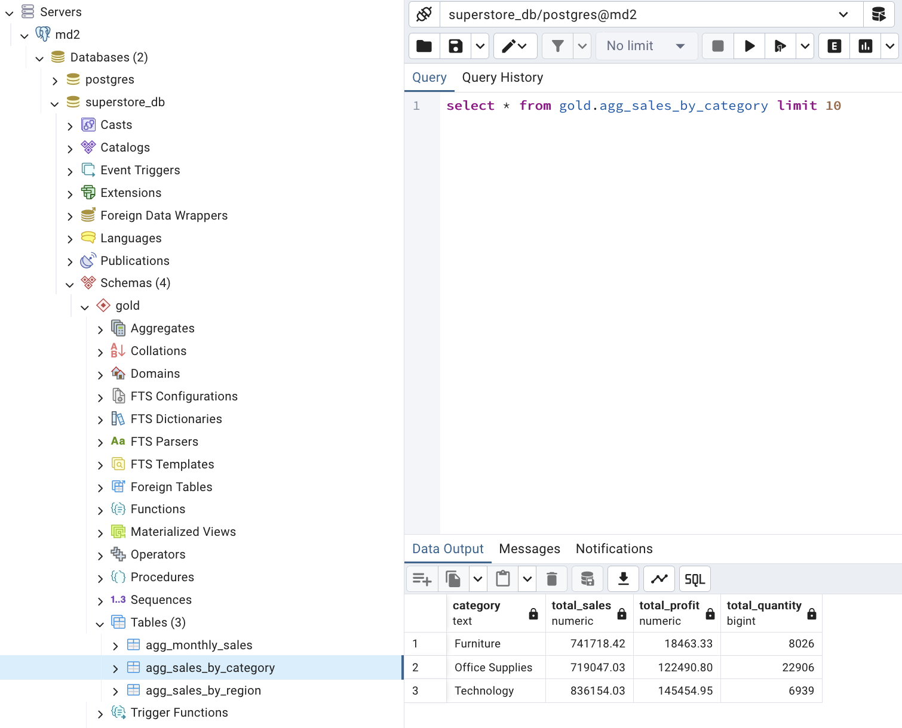
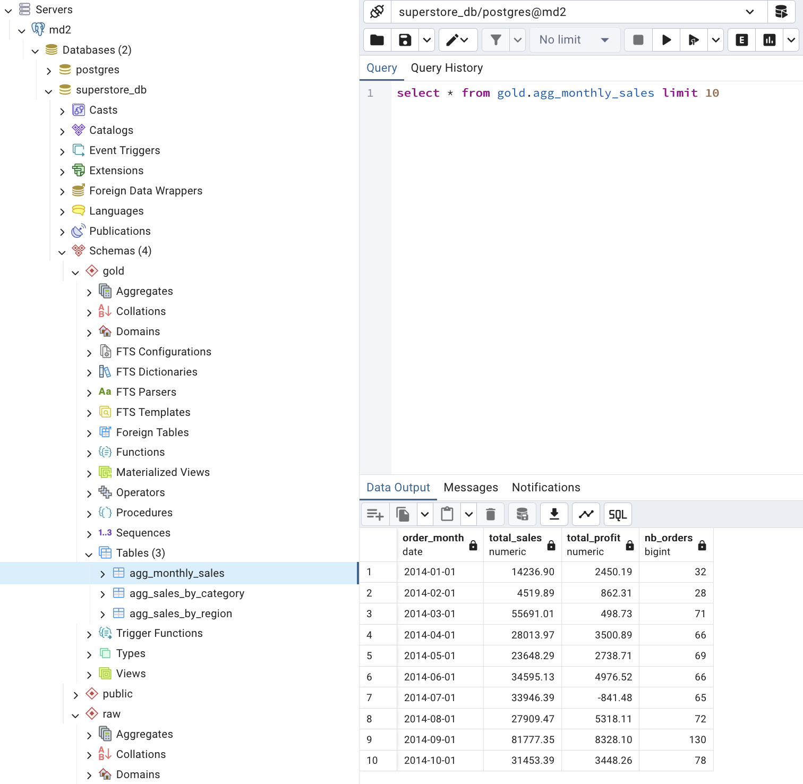

# Data Warehouse Superstore : PostgreSQL + dbt + Grafana

Projet individuel du Master 2 DATA (INGETIS) : *Mise en place d'un Data
Warehouse avec Snowflake et dbt*, appliqué à l'analyse des performances
commerciales du jeu de données **Superstore Sales**.

## Choix techniques

Le projet est réalisé avec des outils libres à la place des solutions
propriétaires du sujet :

| Sujet     | Utilisé ici                              | Conséquence                                                                 |
|-----------|------------------------------------------|-----------------------------------------------------------------------------|
| Snowflake | PostgreSQL 17                            | Identifiants en minuscules : `SUPERSTORE_DB` → `superstore_db`, `RAW.SALES` → `raw.sales` |
| dbt Cloud | dbt Core 1.9 + adaptateur `dbt-postgres` | Exécution en ligne de commande                                              |
| Power BI  | Grafana                                  | Dashboard livré en JSON (importable) + capture d'écran                      |

## Architecture

```text
superstore_db
│
├── raw
│   └── sales                    ← CSV chargé tel quel (script SQL)
│
├── silver
│   └── curation_sales           ← nettoyage et typage (dbt)
│
└── gold
    ├── agg_sales_by_region      ← agrégats (dbt)
    ├── agg_sales_by_category
    └── agg_monthly_sales        → dashboard Grafana
```

```text
data/superstore.csv ──psql \copy──▶ raw.sales ──dbt──▶ silver.curation_sales ──dbt──▶ gold.agg_* ──▶ Grafana
```

## Arborescence du dépôt

```text
.
├── data/superstore.csv                       # fichier source unique (Kaggle)
├── sql/creation_et_chargement_raw.sql     # Partie 1 : base, schémas, RAW
├── dbt_superstore/                           # Parties 2 à 4 : projet dbt
│   ├── dbt_project.yml
│   ├── profiles.example.yml                  # modèle de profil de connexion
│   ├── macros/generate_schema_name.sql       # schémas silver/gold sans préfixe
│   ├── models/sources.yml                    # source raw.sales
│   ├── models/silver/curation_sales.sql
│   ├── models/silver/schema.yml              # documentation + tests SILVER
│   ├── models/gold/agg_*.sql
│   ├── models/gold/schema.yml                # documentation + tests GOLD
│   └── tests/                                # tests génériques et singuliers
├── grafana/dashboard_superstore.json         # Partie 5 : dashboard
└── livrables/                                # résultats des tests et captures
```

## Étapes de réalisation

### Partie 1 : chargement des données (RAW)

Le fichier `Sample - Superstore.csv` (Kaggle `vivek468/superstore-dataset-final`)
est stocké dans `data/superstore.csv`. Le script
[`sql/creation_et_chargement_raw.sql`](sql/creation_et_chargement_raw.sql) :

1. crée la base `superstore_db` si elle n'existe pas ;
2. crée les schémas `raw`, `silver` et `gold` ;
3. crée `raw.sales` avec les noms de colonnes d'origine, **toutes en texte**
   (la couche RAW ne transforme rien ; un format inattendu ne peut pas faire
   échouer le chargement), puis importe le CSV avec `\copy`. Le fichier est
   encodé en **Windows-1252**, ce qui est précisé à l'import ;
4. affiche le nombre de lignes (**9 994**) et un échantillon de 10 lignes.

```bash
# Depuis la racine du dépôt
psql -U postgres -d postgres -f sql/creation_et_chargement_raw.sql
```

### Partie 2 : transformation (SILVER)

Le modèle [`curation_sales.sql`](dbt_superstore/models/silver/curation_sales.sql)
est matérialisé en table `silver.curation_sales` et procède par étapes (CTE) :

| Étape | Traitement |
|-------|------------|
| Renommage | Colonnes en `snake_case` (`"Order Date"` → `order_date`, `"Sub-Category"` → `sub_category`…) ; `trim` et chaînes vides converties en `NULL` |
| Typage | `row_id`, `quantity` → `integer` ; dates `M/D/YYYY` → `date` ; `sales`, `profit` → `numeric(14,4)` ; `discount` → `numeric(5,4)` |
| Valeurs nulles | Lignes sans `row_id` ou `order_id` écartées ; attributs descriptifs absents → `'Non renseigné'` ; remise absente → `0` ; montants laissés `NULL` (jamais inventés) |
| Doublons | Dédoublonnage sur `row_id`, puis sur la ligne complète hors `row_id` : la source contient **1 doublon** (lignes 3406 et 3407 identiques) → 9 993 lignes |
| Délai de livraison | `shipping_delay_days = ship_date - order_date` (0 à 7 jours, 3,96 en moyenne) |
| Corrections de données | 449 codes postaux ayant perdu leur zéro initial (`2138` → `02138`) ; espaces insécables retirés des noms de produits |

### Partie 3 : tests de qualité

Les 5 tests demandés sont définis dans
[`models/silver/schema.yml`](dbt_superstore/models/silver/schema.yml) :

| # | Test | Implémentation |
|---|------|----------------|
| 1 | `row_id` non NULL | `not_null` |
| 2 | `row_id` unique | `unique` |
| 3 | `order_id` non NULL | `not_null` |
| 4 | `quantity` strictement positive | test générique maison [`strictement_positif`](dbt_superstore/tests/generic/strictement_positif.sql) |
| 5 | `discount` entre 0 et 1 | test générique maison [`entre_bornes`](dbt_superstore/tests/generic/entre_bornes.sql) |

S'y ajoutent 28 tests complémentaires (33 au total), dont :

- valeurs acceptées pour `region`, `category` et `segment` ;
- délai de livraison compris entre 0 et 365 jours (pas d'expédition avant la commande) ;
- unicité et non-nullité des clés des 3 tables GOLD ;
- [`coherence_totaux_gold_silver`](dbt_superstore/tests/coherence_totaux_gold_silver.sql) :
  chaque table GOLD restitue le même chiffre d'affaires et le même bénéfice que SILVER ;
- [`coherence_commandes_raw_silver`](dbt_superstore/tests/coherence_commandes_raw_silver.sql) :
  la curation ne perd aucune commande entre RAW et SILVER.

Résultat : `PASS=33 WARN=0 ERROR=0`, cf. [`livrables/dbt_test.log`](livrables/dbt_test.log).

### Partie 4 : tables agrégées (GOLD)

| Table | Grain | Indicateurs |
|-------|-------|-------------|
| [`agg_sales_by_region`](dbt_superstore/models/gold/agg_sales_by_region.sql) | région | `total_sales`, `total_profit`, `nb_orders` |
| [`agg_sales_by_category`](dbt_superstore/models/gold/agg_sales_by_category.sql) | catégorie | `total_sales`, `total_profit`, `total_quantity` |
| [`agg_monthly_sales`](dbt_superstore/models/gold/agg_monthly_sales.sql) | mois (`order_month`, 1er jour du mois) | `total_sales`, `total_profit`, `nb_orders` |

Le nombre de commandes est un `count(distinct order_id)` (une commande compte
plusieurs lignes). Les montants sont arrondis à 2 décimales.

Exécution du projet dbt :

```bash
cp dbt_superstore/profiles.example.yml ~/.dbt/profiles.yml
export DBT_POSTGRES_PASSWORD=...
cd dbt_superstore
dbt debug   # vérifie la connexion
dbt build   # construit SILVER puis GOLD et exécute les tests, dans l'ordre des dépendances
```

### Partie 5 : dashboard (Grafana)

Le dashboard [`grafana/dashboard_superstore.json`](grafana/dashboard_superstore.json)
interroge **uniquement la couche GOLD** via une datasource PostgreSQL. Il
affiche :

- le chiffre d'affaires total, le bénéfice total, la marge et le nombre de commandes ;
- les ventes (CA et bénéfice) par région ;
- les ventes (CA et bénéfice) par catégorie ;
- l'évolution mensuelle du CA et du bénéfice (2014-2017).

Import : *Dashboards → New → Import*, choisir le fichier JSON puis la
datasource PostgreSQL pointant sur `superstore_db`. Un utilisateur en lecture
seule suffit.

## Résultats

| Indicateur | Valeur |
|------------|--------|
| Chiffre d'affaires total | 2 296 919,49 $ |
| Bénéfice total | 286 409,08 $ |
| Marge | 12,5 % |
| Commandes | 5 009 |
| Première région (CA) | West : 725 457,82 $ |
| Première catégorie (CA) | Technology : 836 154,03 $ |

À noter : la catégorie **Furniture** génère 32 % du chiffre d'affaires mais
seulement 6 % du bénéfice (18 463,33 $), ce qui en fait le premier levier
d'amélioration de la rentabilité.

## Livrables

| # | Livrable demandé | Emplacement |
|---|------------------|-------------|
| 1 | Projet dbt complet | [`dbt_superstore/`](dbt_superstore/) |
| 2 | Script SQL de création et de chargement | [`sql/creation_et_chargement_raw.sql`](sql/creation_et_chargement_raw.sql) |
| 3 | Résultats des tests dbt | [`livrables/dbt_test.log`](livrables/dbt_test.log) |
| 4 | Tables RAW, SILVER et GOLD | captures [`raw_sales`](livrables/captures/raw_sales.png), [`silver_curation_sales`](livrables/captures/silver_curation_sales.png), [`gold_agg_sales_by_region`](livrables/captures/gold_agg_sales_by_region.png), [`gold_agg_sales_by_category`](livrables/captures/gold_agg_sales_by_category.png), [`gold_agg_monthly_sales`](livrables/captures/gold_agg_monthly_sales.png) |
| 5 | Dashboard | capture [`dashboard`](livrables/captures/dashboard.png) + [`grafana/dashboard_superstore.json`](grafana/dashboard_superstore.json) |
| 6 | README | ce fichier |

dbt Core étant un outil en ligne de commande (sans interface graphique pour
les résultats de tests), les résultats des tests sont fournis sous forme de
journal d'exécution plutôt que de capture d'écran.

### Captures d'écran

**Dashboard Grafana**



**Tables RAW, SILVER et GOLD (10 premières lignes)**






